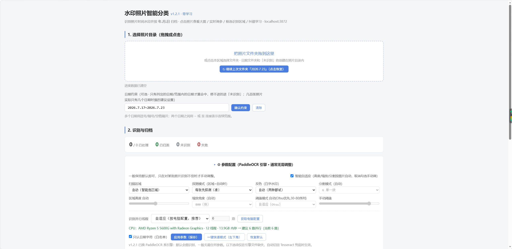
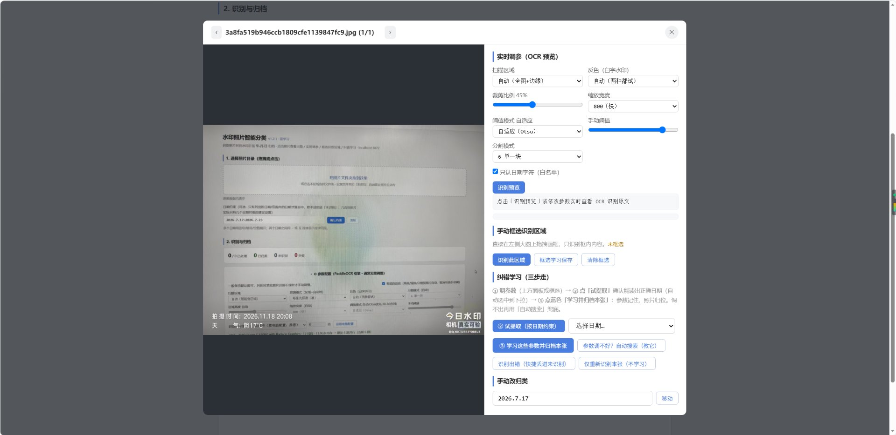

# 水印照片智能分类（watermark-photo-sorter）

本地离线的照片**时间水印识别 + 按日期自动归档**工具。读取手机/相机照片角落的水印日期（如 `2026-05-08`），自动按 `年.月.日` 建文件夹归类，全程不联网、不上传任何照片。

> 适用场景：工地巡检、维修工单、外勤打卡等"照片自带日期水印、事后要按日期整理"的工作流。


---

## ✨ 特性

- **离线本地**：所有识别在本机完成，照片不出本地，无账号、无云端、无费用
- **识别快**：内置 PaddleOCR 系引擎（RapidOCR-json，PP-OCRv4 模型），单张约 **0.6~1 秒**
- **自动归档**：按水印日期建 `2026.5.8` 这样的文件夹，识别失败的统一进 `未识别`
- **并行可调**：默认按电脑配置自适应并行数（低配机 2 路、高配可达 8 路），也可手动指定
- **灯箱纠错**：大图框选日期区域 → 试提取 → 按框归档，一步完成
- **纠错学习**：保存的框选区域按「图片分辨率」记忆，同尺寸照片自动复用（更快更准）
- **日期约束**：白名单或日期范围，只认指定日期，读错数字还能自动修正，防误归类
- **可回查**：识别过程实时日志 + 按日期存档到 `logs/`，事后能查"当时为什么没识别出来"
- **兜底引擎**：引擎文件缺失时自动回退 Tesseract.js，功能不中断

## 📸 截图

**主界面** —— 拖入照片文件夹，填日期约束，一键识别归档：



**灯箱纠错** —— 大图框选日期区域，试提取后一键学习并归档：



## 🚀 快速开始

### 环境要求

- Node.js **18 或更高**（推荐 20/22）
- Windows 10/11（主引擎为 Windows x64 二进制；macOS / Linux 可用兜底引擎）

### 安装

> **不想折腾？** 到 [Releases](https://github.com/leda666/watermark-photo-sorter/releases) 下载 `win64-full.zip`，解压后双击 `start.bat` 即可——包内已自带 Node.js 运行时、依赖和 OCR 引擎，**无需安装任何东西**。

源码方式安装：

```bash
git clone <本仓库地址>
cd watermark-photo-sorter
npm install        # 安装依赖（约 70MB）
npm run setup      # 下载并解压 OCR 引擎（约 70MB，可跳过，见下）
npm start          # 启动，浏览器打开 http://localhost:3872
```

Windows 用户也可直接双击 `start.bat` 启动、`stop.vbs` 停止。

**不装主引擎也能用**：跳过 `npm run setup` 时会自动使用 Tesseract.js 兜底引擎（慢一些、准确率低一些）。
手动安装引擎的方式见 [`engine/README.md`](engine/README.md)。

端口被占用时可以换一个：

```bash
# Windows CMD
set PORT=3880 && npm start
# PowerShell
$env:PORT=3880; npm start
# macOS / Linux
PORT=3880 npm start
```

## 📖 使用

### 1. 基本流程

1. 把照片文件夹（或单个文件夹里的照片）拖进页面顶部虚线框；点击也可选择文件夹
2. （推荐）填写**日期约束**，点「确认约束」
3. 点「开始识别」，照片按日期自动归到 `年.月.日` 文件夹，识别不出的进 `未识别`
4. 可随时暂停 / 继续 / 停止

### 2. 日期约束怎么写

| 写法 | 含义 |
|---|---|
| `2026.5.8` | 只认这一天 |
| `2026.5.8,2026.5.9,2026.5.10` | 白名单，多个日期逗号分隔 |
| `2026.5.1~2026.5.31` | 日期范围（`~` 或「至」） |

分隔符 `.` / `/` / `-` 均可。填完点「确认约束」生效（刷新不丢），点「清除」解除，留空 = 不限制。

### 3. 某张识别不出来怎么办

点照片卡片打开**灯箱** → 按住鼠标**框住日期所在行** → 点「试提取」→ 读出日期后点「保存参数学习并归档」。
保存后，**同尺寸（分辨率相同）的照片会自动优先复用这个框**，识别更快也更稳。

### 4. 并行线程

`参数配置 → 识别并行线程`：

- **自适应**（默认）：按 CPU 线程数与内存给出建议值（≤4 线程 → 2 路，≤8 → 4 路，≤16 → 6 路）
- **自定义**：1~16 路手动指定；点「获取电脑配置」可查看本机核数与建议值

线程数越高单批吞吐越大，但超过物理核心太多收益会递减。

## 🧱 目录结构

```
├── server.js              # Express 服务：任务调度、文件移动、日志、接口
├── lib/
│   ├── recognizer.js      # 识别引擎层（RapidOCR-json 调用 + Tesseract 兜底 + 日期解析）
│   └── learn.js           # 学习库（按图片分辨率记忆框选区域 / 参数）
├── public/index.html      # 单页前端（拖拽、灯箱、日志、关于）
├── engine/                # OCR 引擎（需 npm run setup，仓库不含二进制）
├── tessdata/              # 兜底引擎 Tesseract 模型（eng + chi_sim）
├── scripts/download-engine.js
├── logs/                  # 运行时生成：按日期存档的日志
├── learnings.json         # 运行时生成：学习库
└── settings.json          # 运行时生成：线程设置
```

识别一张图的流程：

```
读图 → 有学习记录的框选区域就先用它 → 否则全图识别
     → 没读出日期则依次试「下部 55%」「下部 35%」裁剪
     → 从识别文本中解析日期（多格式 + 时间屏蔽 + 数字混淆修复 + 日期约束过滤）
     → 命中则移动到 年.月.日/ 目录
```

## ❓ 常见问题

**Q：照片路径/文件名是中文，会不会识别失败？**
不会。引擎本身只认 ASCII 路径，程序内部会自动把图片复制到系统临时目录再识别，用户无感。

**Q：`npm run setup` 下载失败 / 解压失败？**
国内网络可能访问 GitHub 较慢，可手动下载 `RapidOCR-json_v0.2.0.7z` 后用 7-Zip 解压到 `engine/`，
详见 [`engine/README.md`](engine/README.md)。

**Q：识别很慢？**
1) 确认 `engine/` 已安装（未安装会走 Tesseract 兜底，慢一个数量级）；
2) 参数配置里把并行线程调到建议值以上；
3) 超大切图（4000px 以上）单张会更久，属正常。

**Q：会不会上传我的照片？**
不会。没有遥测、没有云端调用，`node_modules` 里的引擎也只在本机跑。照片只在本地被读取和移动。

**Q：移动过的照片还能恢复吗？**
程序只做「移动到日期同名文件夹」，不删除文件。原文件名保留，重名会自动加 `(1)` 后缀。

## 🛠 开发

- 后端：Node.js + Express，SSE 推送进度，`execFile` 调用引擎进程
- 前端：原生 JS 单文件（无构建步骤），`File System Access API` 直接读写本地文件夹
- 新增识别引擎：在 `lib/recognizer.js` 中扩展 `paddleAvailable()` / `recognizeWithPaddle()` 同层逻辑即可，
  日期解析与归档逻辑完全复用

## 👤 作者

- 作者：**哒哒**
- 微信公众号：**Tendered**
- 资源站：**轻Q魔客** · https://www.qqmo.cn
- QQ：198999397（问题反馈 / 使用交流）

如果这个工具帮到了你，欢迎点个 ⭐ Star，或在你的工作流里推荐给同事。

## 📄 License

[MIT](LICENSE)。第三方组件与模型见 [THIRD-PARTY-NOTICES.md](THIRD-PARTY-NOTICES.md)。

## ⚠️ 免责声明

本工具按「现状」提供，识别结果可能出错，请在生产使用前抽查归档结果。
